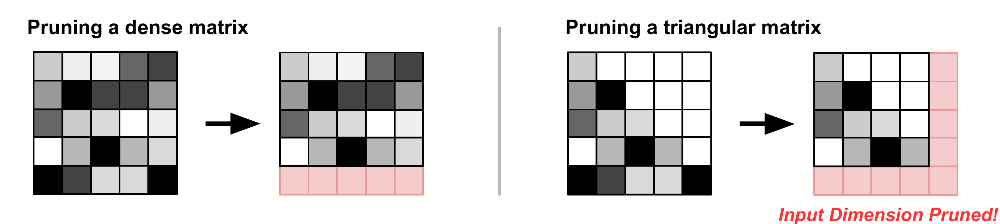

# Subspace Node Pruning (SNP)

Official code for [*Subspace Node Pruning: Retraining-Free Neural Network Compression via Orthogonal Subspace Projections*](https://arxiv.org/abs/2405.17506).

## How it works

**Calibration.** Units in a layer are correlated, so the importance of one unit depends on which others are kept, and scoring units one at a time is unreliable. SNP projects each layer's units into a subspace where they are uncorrelated. There, the cost of pruning a set of units is simply the sum of their individual scores.

**Triangular projection.** With a dense projection, every subspace unit mixes all inputs, so removing one only gives a low-rank approximation and the network does not get smaller. With a triangular projection, the last input feeds only the last subspace unit, so pruning that unit removes the input itself.



## Installation

```bash
pip install -e .
```

We ran the experiments with:

```
python==3.14
torch==2.9.0
torchvision==0.24.0
torch-pruning==1.6.1
numpy==2.3.4
tqdm==4.67.1
transformers==5.17.0
datasets==5.0.1
matplotlib==3.10.7
jupyter==1.1.1
```

## Running the paper experiments

The experiments are in the notebooks:

- `vgg16_pruning.ipynb`: VGG-16 on ImageNet. Choose the importance score by setting `importance_score` to one of `tso`, `act`, `pfa` or `saw`.
- `resnet50_group_pruning.ipynb`: ResNet-50 on ImageNet.
- `opt_layer_pruning.ipynb`: OPT-125M on WikiText-2.

For the vision notebooks, set `data_path` to your ImageNet folder.

The notebooks use a coarser choice of pruning ratios than the paper so they run faster. The paper's experiments used a finer granularity, which takes considerably longer.

## Citation

```bibtex
@misc{offergeld2026subspace,
  title         = {Subspace Node Pruning: Retraining-Free Neural Network Compression via Orthogonal Subspace Projections},
  author        = {Offergeld, Joshua and Chidiac, John and van Gerven, Marcel and Ahmad, Nasir},
  year          = {2026},
  eprint        = {2405.17506v4},
  archivePrefix = {arXiv},
  primaryClass  = {cs.LG},
  url           = {https://arxiv.org/abs/2405.17506v4}
}
```